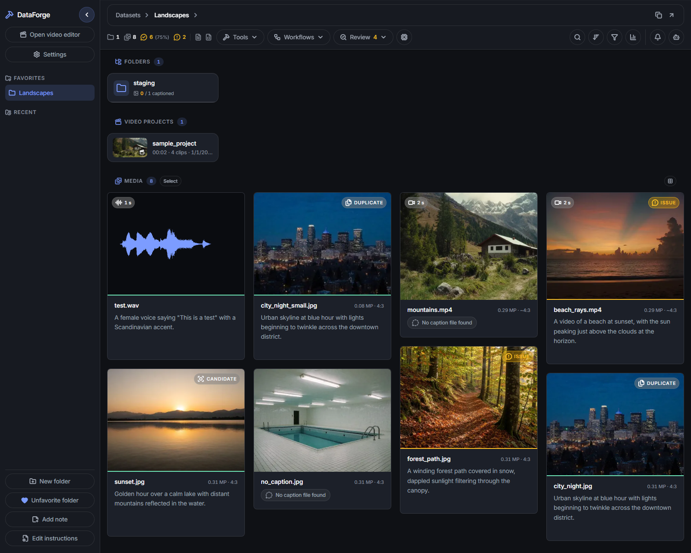

# DataForge

**A local gallery and automation app for image and video caption datasets.**

[](https://github.com/cupraai/dataforge/actions/workflows/checks.yml)
[](LICENSE)
[](https://www.python.org/)
[](https://nodejs.org/)
[](docs/getting-started.md#requirements)



Browse, caption, review, and edit datasets for LoRA training and fine-tuning. Open any folder: captions are plain `.txt` files beside the media, so there is no library to import into.

## Quick start

[Download and extract the project](docs/getting-started.md#install-and-run), or clone it with Git, then:

| Platform | Run | Notes |
| --- | --- | --- |
| Windows | `setup.bat` once, then `start.bat` | Setup downloads its own Python, Node, and FFmpeg; nothing needs to be installed globally |
| Linux and macOS | `./setup.sh` once, then `./start.sh` | Install Python 3.13.x, FFmpeg 7.1.x, and a [supported Node version](docs/getting-started.md#requirements) first |

The app opens at `http://localhost:18081`. Open [`sample_media/`](sample_media/) to try it on an example dataset. [Getting started](docs/getting-started.md) covers updating and troubleshooting.

## What it does

- **Browse and organize:** live folder updates, search (including regex and [tags](docs/user-guide.md#tags)), filters, sorting, card and list views, and file operations.
- **Caption:** manual editing with autosave and word completion; bulk set, find & replace, AI rewriting, backups, and undo.
- **Auto-caption:** write image and video captions with an OpenAI-compatible vision model, optionally hearing the video's audio.
- **Review:** model checks, caption-rule linting, near-duplicate detection, and dataset statistics.
- **Edit media:** crop, resize, color adjustment and Auto-adjust, blur or black out regions, generative fill, video trim/speed/audio, and audio editing. The original is kept so you can revert.
- **Video editor:** cut videos, stills, sound, and titles together on a multi-track timeline with dissolves, fades, and per-clip color, then export an MP4. See the [Video editor guide](docs/video-editor.md).
- **Process:** run ComfyUI workflows and review each result before accepting it, one by one or in bulk.
- **Train:** start and monitor LoRA training on the current folder through Ostris AI-Toolkit, then inspect the resulting `.safetensors` files in the gallery.

AI is optional. Browsing, manual captioning, editing, and most bulk tools work without a model. Install and run the services you want separately, then connect them in **Settings**:

| Service | Default address | Used for | Guide |
| --- | --- | --- | --- |
| OpenAI-compatible vision server | `http://127.0.0.1:8888/v1` | Auto-caption, Verify captions, Edit captions | [Configuration](docs/configuration.md#connect-a-vision-model) |
| ComfyUI | `http://127.0.0.1:9000` | Process with ComfyUI, generative fill | [ComfyUI](docs/comfyui.md) |
| AI-Toolkit | `http://127.0.0.1:8675` | Quick LoRA training | [LoRA training](docs/ai-toolkit.md) |

<a id="your-data-stays-local"></a>

## Data and storage

- **With the dataset:** captions, folder instructions, review findings, and edit originals.
- **In `backend/data/`** (by default): app settings, job history, and thumbnails.
- **Leaving your machine:** nothing by default, since every integration defaults to a local address. A remote endpoint receives that job's inputs; see [data sent to integrations](docs/configuration.md#data-sent-to-integrations).

A few operations cannot be undone: accepting a ComfyUI result (it replaces the source without a backup), **Strip metadata**, and **Rename**. The guides point this out beside each one.

## Documentation

| Guide | Covers |
| --- | --- |
| [Getting started](docs/getting-started.md) | Requirements, install, run, update, and startup troubleshooting |
| [User guide](docs/user-guide.md) | Browse, caption, review, edit, and run jobs; formats, files, and shortcuts |
| [Video editor](docs/video-editor.md) | Edit timelines, manage projects, preview, export, and editor shortcuts |
| [Configuration](docs/configuration.md) | Recommended models, Settings, input budgets, and environment variables |
| [ComfyUI](docs/comfyui.md) | Process media, review results, write presets, and set up generative fill |
| [AI-Toolkit](docs/ai-toolkit.md) | Choose a template, start training, and monitor LoRA runs |
| [Development](docs/development.md) | Hot reload, generated code, checks, CI, and versioning |

The [documentation index](docs/README.md) links straight to common tasks.

## Contributing

Issues and pull requests are welcome. Read [Development](docs/development.md) and [AGENTS.md](AGENTS.md), then run the full checks from the project root:

```bash
backend/.venv/Scripts/python scripts/run_checks.py --fix
```

On Linux and macOS, use `backend/.venv/bin/python`. Report vulnerabilities privately as described in [SECURITY.md](SECURITY.md).

## License

[Apache License 2.0](LICENSE)
